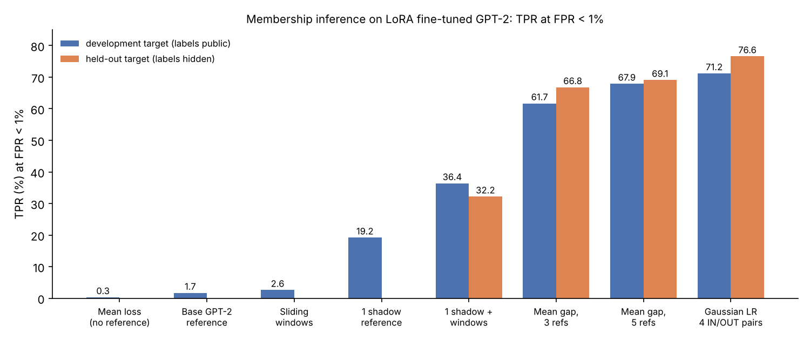
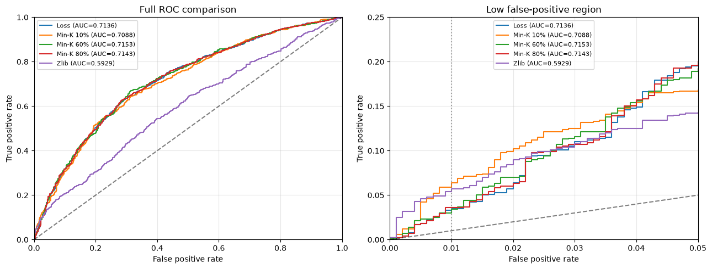

# Membership Inference Attacks on Fine-Tuned GPT-2

Can you tell whether a piece of text was in a language model's fine-tuning data? This project measures how much membership leaks from GPT-2 fine-tuned on WikiText-103, with a focus on the regime that matters for a privacy audit: **the true-positive rate at a false-positive rate below 1%**.

It has two parts:

1. **Reference-free attacks** (loss, Min-K%, zlib) on a fully fine-tuned GPT-2. These need one forward pass and no extra models, and they barely work at low FPR.
2. **Reference-model attacks** on GPT-2 + LoRA. A per-text Gaussian likelihood ratio calibrated with complementary IN/OUT shadow models reaches **76.6% TPR at FPR < 1%** on a target whose labels I never saw, up from under 3% without references. The second half of this part documents a long list of ideas that did not beat it, and why.

Built as a project for Foundations of Privacy at CMU (Fall 2026).

<p align="center">
  
</p>

---

## Part 1: Reference-free attacks

**Threat model.** Logit access to the target and a candidate text. No shadow or reference models. Labels are used only for evaluation.

| Attack | Score (higher = member) | Idea |
|---|---|---|
| **Average loss** | negative mean token cross-entropy | Training exposure makes member texts more predictable. |
| **Min-K%** ([Shi et al., 2024](https://arxiv.org/abs/2310.16789)) | negative mean of the K% highest token losses | Even a member's hardest tokens should be less surprising. |
| **zlib-normalized loss** ([Carlini et al., 2021](https://arxiv.org/abs/2012.07805)) | mean loss / zlib-compressed byte length | Discount texts that are easy for reasons unrelated to memorization. |

Next-token alignment, per-token losses with padding masked out of both sum and count, inputs truncated at 256 tokens. Min-K% at K = 100% reproduces average loss exactly (`np.allclose`, atol 1e-5).

**Results** (2,000 texts, 1,000 members):

| Attack | AUC | TPR @ FPR < 1% | TPR @ FPR < 5% |
|---|---|---|---|
| Average loss | 0.7136 | 3.3% | 19.5% |
| Min-K 5% | 0.7050 | 5.4% | 17.0% |
| **Min-K 10%** | 0.7088 | **5.9%** | 16.7% |
| Min-K 20% | 0.7085 | 4.5% | 18.1% |
| Min-K 40% | 0.7108 | 3.2% | 19.1% |
| **Min-K 60%** | **0.7153** | 3.0% | 18.9% |
| Min-K 80% | 0.7143 | 3.6% | **19.6%** |
| zlib | 0.5929 | 5.4% | 14.2% |

<p align="center">
  
</p>

- **Membership leaks, but weakly where it matters.** AUC 0.71, yet only 33 of 1,000 members are found at FPR < 1%.
- **Min-K% trades regimes rather than improving overall.** K = 10% nearly doubles low-FPR detection but lowers AUC.
- **zlib normalization hurts** here (AUC 0.59).
- **Low loss signals predictability, not membership.** Easy non-members are the main source of false positives, which motivates Part 2.

---

## Part 2: Reference-model attacks on LoRA fine-tuned GPT-2

### Setting

- **Targets:** three GPT-2 models with LoRA adapters (rank 32, alpha 64, dropout 0.05, 3 epochs, block 512, batch 8, lr 2e-4), each fine-tuned on a different 10,000-paragraph sample of WikiText-103.
- **Candidates:** 2,000 texts per target, 1,000 members and 1,000 non-members.
- **Labels:** public for the development target only. The held-out target's labels stay on an evaluation server, which returns TPR at FPR < 1% for a submitted score file.
- **Metric:** `max(tpr[fpr < 0.01])`. With 1,000 non-members, the threshold sits at about the 10th highest-scoring non-member, so a handful of texts moves the score by points.
- **White-box access** to the target's weights, logits and losses. I train my own shadow models with the target's recipe.

### The attack

**1. Shadow models in complementary pairs (online LiRA).** All candidate texts from every evaluation set are merged into overlap groups, using union-find over whitespace-normalized text *and* identical scored-token prefixes, so near-duplicates always move together. For each pair, a seeded rule assigns every group to exactly one side. Model A trains on its side plus auxiliary WikiText paragraphs, and model B on the other side. **Every candidate is IN exactly one model of each pair**, which is asserted for every set. Auxiliary paragraphs are filtered against every candidate by text and prefix. In total I trained 12 paired shadows and 2 OUT-only shadows, about 25 minutes each on a T4. The released targets also serve as OUT references wherever their known training data allows, and are masked where it doesn't.

**2. Statistic.** u = √T · (mean token loss), where T is the number of scored tokens. Treating mean loss as a √T-scaled sum was one of the largest single improvements.

**3. Per-text Gaussian likelihood ratio** (`src/mia_lora/attacks.py: gaussian_lr`). For each text, the IN references (shadows trained on it) and OUT references give means μ_in, μ_out and residual sums of squares. Each per-text variance is shrunk toward the pooled variance with strength κ = 8, an inverse-gamma prior worth 8 pseudo-observations, then inflated by (1 + 1/n) to make it predictive:

```
s²_side = (RSS_side + κ · pooled_side) / (df_side + κ) · (1 + 1/n_side)
score   = log N(u; μ_in, s²_in) − log N(u; μ_out, s²_out)
```

κ, the reference rule and the decision to submit were all fixed on shadow "mock" targets before any held-out score was requested, and the method was submitted once.

### Methods implemented and their sources

Every method below is implemented in this repo. The ones marked *adapted* differ from the paper in a way the notebook documents.

| Method | Role here | Where | Source |
|---|---|---|---|
| Loss attack | baseline | `01`, `02` | [Yeom et al., 2018](https://arxiv.org/abs/1709.01604) |
| Min-K% | reference-free baseline | `01` | [Shi et al., 2024](https://arxiv.org/abs/2310.16789) |
| zlib-normalized loss | reference-free baseline | `01` | [Carlini et al., 2021](https://arxiv.org/abs/2012.07805) |
| Reference-model (difficulty-calibrated) loss: mean loss gap × √T | first strong attack; OUT-side baseline throughout | `02`, `03`, `attacks.mean_gap` | [Watson et al., 2022](https://arxiv.org/abs/2111.08440); [Mireshghallah et al., 2022](https://arxiv.org/abs/2203.03929) |
| Sliding-window voting | early aggregation over token windows (*own design*) | `02` | none |
| Gradient-norm signal | white-box feature, dropped | `02` | [Nasr et al., 2019](https://arxiv.org/abs/1812.00910) |
| Online LiRA with complementary IN/OUT shadow pairs | **core of the final attack** | `02`, `03`, `data.assign_complementary` | [Carlini et al., 2022](https://arxiv.org/abs/2112.03570) |
| Per-text Gaussian LR with shrunk (moderated) variances | **final attack** (*adapted*: LiRA's Gaussian test with per-text variances shrunk toward pooled ones, in the form of empirical-Bayes moderated variances) | `03`, `attacks.gaussian_lr` | [Carlini et al., 2022](https://arxiv.org/abs/2112.03570); [Smyth, 2004](https://doi.org/10.2202/1544-6115.1027) |
| Shared-variance and OUT-only LR | variants of the final attack | `06`, `attacks.shared_variance_lr` | [Carlini et al., 2022](https://arxiv.org/abs/2112.03570) (fixed- and offline-variance variants) |
| Token-level Gaussian LR | variant | `06` | own design, after [Carlini et al., 2022](https://arxiv.org/abs/2112.03570) |
| Reference-subset bagging | variant | `04` | [Breiman, 1996](https://doi.org/10.1007/BF00058655) |
| RMIA | alternative attack (online, trimmed reference mean) | `06`, `attacks.rmia_log_ratio` | [Zarifzadeh et al., 2024](https://arxiv.org/abs/2312.03262) |
| EZ-MIA (error-zone ratio) | alternative attack, checked against the official code | `05`, `attacks.ez_error_zone_ratio` | [Ilić et al., 2026](https://arxiv.org/abs/2601.12104) |
| Logistic ensembles of LR, mean gap, RMIA | combination | `07` | stacking on shadow-model membership, as in [Shokri et al., 2017](https://arxiv.org/abs/1610.05820) |
| Tail-focused pairwise ranking combiner | combination optimized for the low-FPR region | `04`, `combine.tail_rank_fit` | partial-AUC optimization, [Narasimhan & Agarwal, 2013](https://proceedings.mlr.press/v28/narasimhan13.html) |
| G-Drift | alternative white-box signal (*adapted* to plain text and LoRA; raw and reference-calibrated) | `07` | [Ranjan et al., 2026](https://arxiv.org/abs/2604.00419) |
| ReCaLL | alternative signal (*adapted*: non-member prefixes from WikiText validation, reference-calibrated) | `08`, `04` | [Xie et al., 2024](https://arxiv.org/abs/2406.15968) |
| Target calibration on known non-members | quantile-regression idea, tested as a gate and a variance correction | `08` | [Bertran et al., 2023](https://arxiv.org/abs/2307.03694) |

### Results (TPR at FPR < 1%)

| Method | Development | Held-out |
|---|---|---|
| Mean loss, no reference | 0.3% | n/a |
| Single shadow reference | 19.2% | n/a |
| Single shadow + sliding-window voting | 36.4% | 32.2% |
| Mean loss gap × √T, 3 references | 61.7% | 66.8% |
| Mean loss gap × √T, 5 references | 67.9% | 69.1% |
| Mean gap + IN-model feature (logistic) | 70.0% (out-of-fold) | 67.1% |
| **Gaussian LR, κ = 8, 4 IN/OUT pairs** | **71.2%** (AUC 0.974) | **76.6%** |

### What did not help, and why

Each idea was tested against the frozen Gaussian LR with the same references, mostly with a strict protocol: **leave one shadow pair out, both as training rows and from every feature's reference pool, and evaluate on held-out text groups.** Differences come with stratified paired-bootstrap intervals.

| Idea | Outcome |
|---|---|
| **More references:** 6 IN/OUT pairs instead of 4 | Better on development (73.4%) and on fresh shadow targets (+6.6 points), but **71.3% held-out**, 5.3 points worse. The scores correlate at 0.99; 19 texts near the threshold changed places. |
| **Bagging reference subsets** (mean of all 15 four-pair LRs) | 74.6% on development, but below the pooled LR on both fresh shadow targets. Not validated. |
| **Shared-variance and OUT-only LR variants** | Tied or lost against unequal-variance LR. |
| **Token-level Gaussian LR** | Collapsed to 19 to 24% on development. Per-position variation swamps the per-model signal. |
| **RMIA** (online, trimmed reference mean, both statistics) | Did not exceed Gaussian LR with the same references. |
| **EZ-MIA** (error-zone log-prob ratio) | With an in-domain shadow reference: 21 to 24%, versus 44 to 45% for a plain loss gap with the *same* single reference. |
| **Logistic ensembles** of LR + mean gap (+ RMIA) | −1.4 points held-out-pair; −1.3 and −0.6 points on four untouched shadow models. Gains in AUC, losses in the tail. |
| **Tail-focused combiner** (pairwise loss vs the top 5% of non-members) | With the low-FPR region optimized directly, the weights collapse back to LR (extra weights ≤ 0.006 vs 3.7). |
| **G-Drift** (feature drift after one gradient-ascent step) | Raw drift features are near chance (AUC 0.51 to 0.54). Calibrated per text against IN/OUT references: AUC 0.61, no gain over LR. |
| **ReCaLL** (loss change under a non-member prefix) | A real but weak signal (AUC 0.70 alone, 6 to 8% TPR). Combined with LR: +0.1 points held-out-pair, and 76.5% vs 76.6% on the held-out target. |
| **Target calibration on known non-members** (quantile-regression idea) | On 3,462 WikiText validation/test paragraphs, which are non-members of every model, references predict each real target without bias, and the residual is unpredictable from text features (R² < 1%). A label-free variance correction changed nothing. |

### Findings

- **Reference models are the lever.** Going from no reference to five took low-FPR detection from under 3% to 69%. Calibrating with IN *and* OUT references per text added another 7.5 points on the held-out target.
- **Shadow targets can be optimistic.** Shadows that share auxiliary training data with the references sit unusually close to them, which inflates mock-target scores. Shadows with freshly sampled auxiliary data behave like the real targets.
- **The tail is noisy.** Two methods with nearly identical rankings (correlation 0.99) differed by 5 points on the held-out target. Development scores and shadow targets did not predict that difference reliably.
- **The per-text loss signal looks saturated.** Six complementary signals carry some membership information (AUC up to 0.70 alone), but none adds to the Gaussian LR at FPR < 1%.

### Evaluation hygiene

- No development labels are used as attack features, and shadow membership is kept separate from target membership.
- Parameters and combiners were selected on shadow targets only. Where a pair is held out, it is excluded from both the training rows and every reference pool, and scaling is fit on training folds.
- Every cached forward pass is checked for alignment against fresh tokenization. Cached features are reused only if their metadata (adapter hash, text order, settings) matches.
- Held-out submissions were few and decided in advance, so the reported 76.6% is not the best of many tries.

---

## Repository

```
notebooks/
  01_reference_free_attacks.ipynb                 loss, Min-K%, zlib (Part 1)
  02_sliding_windows_and_shadow_references.ipynb  windows, first shadow, mean-gap attack, gradient norms, first IN/OUT pair
  03_online_lira_paired_shadows.ipynb             pair construction, staged Gaussian LR, mock targets, near-duplicate audit, frozen attack
  04_reference_scaling_bagging_and_combiners.ipynb pairs 5-6, rank diagnostics, bagging, ensemble transfer, tail combiner, ReCaLL test
  05_ez_mia_error_zone.ipynb                      EZ-MIA, checked against the reference implementation
  06_rmia_and_likelihood_ratio_variants.ipynb     RMIA, LR variance variants, token-level LR
  07_ensembles_and_gradient_drift.ipynb           held-out-model ensembles, G-Drift pilot and full test, calibrated drift
  08_recall_and_quantile_calibration.ipynb        ReCaLL extraction, non-member pool, target-calibration gate
src/mia_lora/                                     reusable implementation
  data.py      normalization, text/prefix membership, overlap groups, complementary splits
  losses.py    per-token losses for base model + LoRA adapter
  attacks.py   Gaussian LR, mean gap, shared-variance LR, RMIA, EZ-MIA
  combine.py   tail-focused pairwise ranking combiner
  metrics.py   strict TPR at FPR, stratified paired bootstrap
tests/         unit tests (the Gaussian LR is checked against the notebook implementation)
scripts/plot_results.py
figures/
```

The notebooks keep their outputs and were run on Colab (T4). They read cached losses and shadow adapters from Google Drive. Models, cached losses and the evaluation data are not included.

```bash
pip install -r requirements.txt
pip install -e .
pytest -q
```

```python
from mia_lora import gaussian_lr, tpr_at_fpr
# t: target mean loss (N,), L: scored tokens (N,), P: reference mean losses (K, N), Pin: reference trained on text (K, N)
scores = gaussian_lr(t, L, P, Pin, kappa=8)
```

## References

- Yeom, Giacomelli, Fredrikson, Jha (2018). [*Privacy Risk in Machine Learning: Analyzing the Connection to Overfitting.*](https://arxiv.org/abs/1709.01604) IEEE CSF.
- Shokri, Stronati, Song, Shmatikov (2017). [*Membership Inference Attacks Against Machine Learning Models.*](https://arxiv.org/abs/1610.05820) IEEE S&P.
- Nasr, Shokri, Houmansadr (2019). [*Comprehensive Privacy Analysis of Deep Learning.*](https://arxiv.org/abs/1812.00910) IEEE S&P.
- Carlini et al. (2021). [*Extracting Training Data from Large Language Models.*](https://arxiv.org/abs/2012.07805) USENIX Security.
- Watson, Guo, Cormode, Sablayrolles (2022). [*On the Importance of Difficulty Calibration in Membership Inference Attacks.*](https://arxiv.org/abs/2111.08440) ICLR.
- Mireshghallah et al. (2022). [*Quantifying Privacy Risks of Masked Language Models Using Membership Inference Attacks.*](https://arxiv.org/abs/2203.03929) EMNLP.
- Carlini et al. (2022). [*Membership Inference Attacks From First Principles*](https://arxiv.org/abs/2112.03570) (LiRA). IEEE S&P.
- Smyth (2004). [*Linear Models and Empirical Bayes Methods for Assessing Differential Expression in Microarray Experiments.*](https://doi.org/10.2202/1544-6115.1027) SAGMB (moderated variances).
- Breiman (1996). [*Bagging Predictors.*](https://doi.org/10.1007/BF00058655) Machine Learning.
- Narasimhan, Agarwal (2013). [*A Structural SVM Based Approach for Optimizing Partial AUC.*](https://proceedings.mlr.press/v28/narasimhan13.html) ICML.
- Bertran et al. (2023). [*Scalable Membership Inference Attacks via Quantile Regression.*](https://arxiv.org/abs/2307.03694) NeurIPS.
- Zarifzadeh, Liu, Shokri (2024). [*Low-Cost High-Power Membership Inference Attacks*](https://arxiv.org/abs/2312.03262) (RMIA). ICML.
- Shi et al. (2024). [*Detecting Pretraining Data from Large Language Models*](https://arxiv.org/abs/2310.16789) (Min-K%). ICLR.
- Xie et al. (2024). [*ReCaLL: Membership Inference via Relative Conditional Log-Likelihoods.*](https://arxiv.org/abs/2406.15968) EMNLP.
- Ilić, Stanojević, Cvejoski (2026). [*Powerful Training-Free Membership Inference Against Fine-Tuned Autoregressive Language Models*](https://arxiv.org/abs/2601.12104) (EZ-MIA). ACL.
- Ranjan, Grover, Lin, Polyzou (2026). [*G-Drift MIA: Membership Inference via Gradient-Induced Feature Drift in LLMs.*](https://arxiv.org/abs/2604.00419) arXiv.
- Hu et al. (2022). [*LoRA: Low-Rank Adaptation of Large Language Models.*](https://arxiv.org/abs/2106.09685) ICLR.
- Merity et al. (2016). [*Pointer Sentinel Mixture Models*](https://arxiv.org/abs/1609.07843) (WikiText-103).
- Radford et al. (2019). *Language Models are Unsupervised Multitask Learners* (GPT-2).
